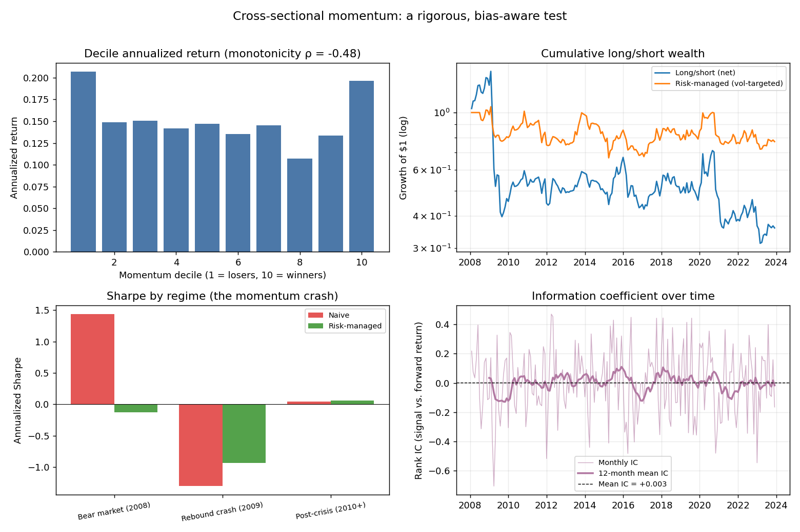
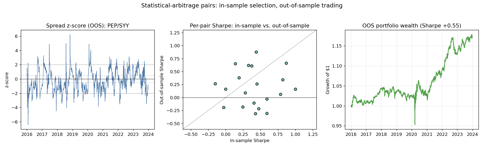
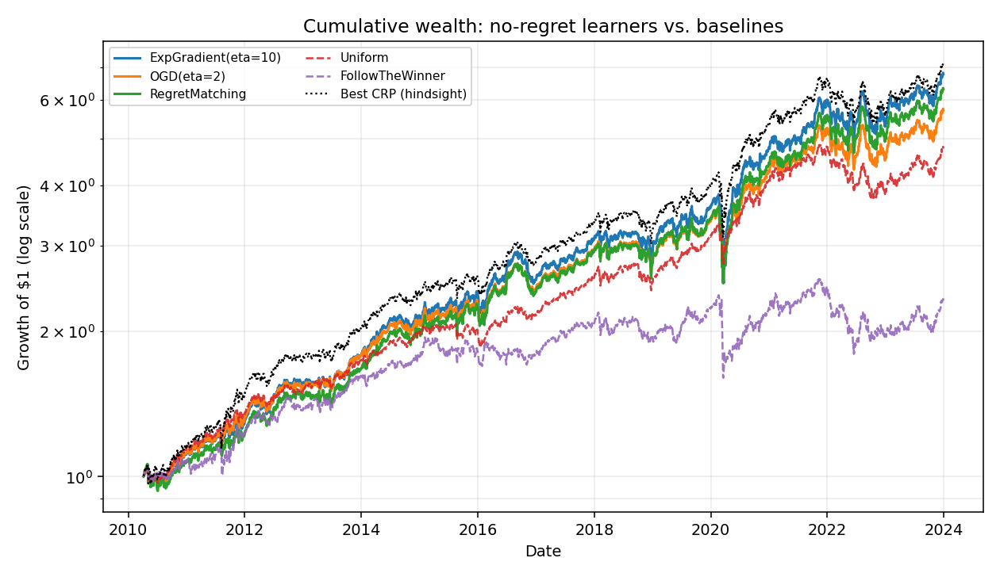
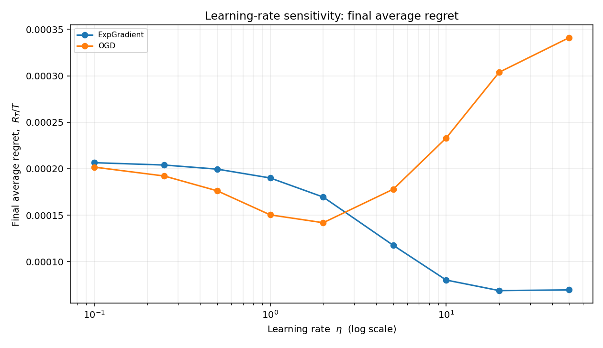
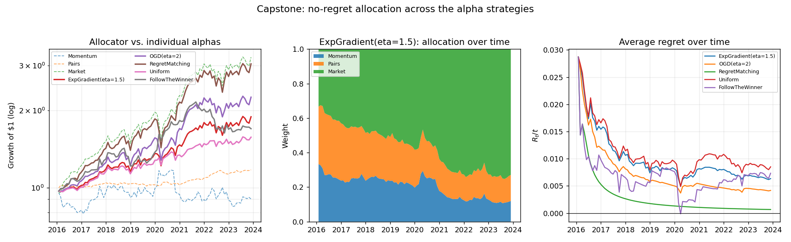

# No-Regret Allocator

[](https://github.com/coreyczhang/no-regret-allocator/actions/workflows/ci.yml)
[](https://www.python.org/)
[](LICENSE)
[](https://github.com/psf/black)
[](https://mypy-lang.org/)

**A two-layer quantitative trading system: rigorously-evaluated alpha strategies, plus a no-regret online-learning meta-allocator that adaptively allocates capital across them.**

```
 Layer 1 — Alphas                         Layer 2 — Meta-allocator
 ┌──────────────────────────┐             ┌────────────────────────────┐
 │ Cross-sectional momentum │──returns──▶ │ No-regret online learning  │
 │ Stat-arb pairs trading   │──returns──▶ │ (EG / OGD / Regret Matching)│──▶ capital
 │ Equity market            │──returns──▶ │ provably ≈ best in hindsight│    weights
 └──────────────────────────┘             └────────────────────────────┘
```

Each alpha is built and evaluated as a standalone strategy with its own evidence;
the allocator then treats the alphas' return streams as inputs and learns, online,
how to split capital across them — with a provable guarantee that it approaches
the best fixed allocation in hindsight.

> **Research / educational implementation. Not investment advice.** The strategies
> are deliberately simple and every result is reported honestly, including where
> an edge is weak or absent. See [Honest limitations](#honest-limitations).

---

## Table of contents

- [Layer 1 — the alphas](#layer-1--the-alphas)
  - [Cross-sectional momentum](#cross-sectional-momentum)
  - [Statistical-arbitrage pairs trading](#statistical-arbitrage-pairs-trading)
- [Layer 2 — the no-regret allocator](#layer-2--the-no-regret-allocator)
- [Capstone: allocating across the alphas](#capstone-allocating-across-the-alphas)
- [Honest limitations](#honest-limitations)
- [Architecture](#architecture) · [Reproducing](#reproducing-the-results) · [Testing](#testing) · [References](#references)

---

## Layer 1 — the alphas

Both alphas run on a cached panel of ~140 liquid US large-caps (2007–2023), with
a GICS-style sector label per name.

### Cross-sectional momentum

Rank stocks by trailing return, go **long the winners and short the losers**, and
measure whether the edge actually holds — the way a researcher would, not a
tutorial. The spec: monthly **12-1** formation (skip the most recent month to
avoid short-term reversal), decile portfolios, dollar-neutral long-top/short-bottom.



**The honest finding.** In this liquid large-cap universe, cross-sectional price
momentum has **essentially no monotonic edge** (information coefficient ≈ 0,
U-shaped deciles) and is defined by its signature **crash**:

| Regime | Naive Sharpe | Risk-managed Sharpe |
|---|---:|---:|
| Bear market (2008) | **+1.44** | −0.13 |
| Rebound crash (2009) | **−1.30** | −0.93 |
| Post-crisis (2010+) | +0.05 | +0.06 |

Momentum earns strongly while a bear market trends (shorting falling losers), then
suffers a violent loss in the panicked rebound (spring 2009) — the *momentum crash*
of Daniel & Moskowitz (2016). A **volatility-targeting overlay** roughly halves the
worst drawdown (−78% → −37%) by cutting exposure when the strategy's own volatility
spikes; it tames the tail but cannot manufacture a premium that is not there.

Reporting this null honestly — rather than curve-fitting a flattering backtest — is
the point. The evaluation machinery (IC, decile monotonicity, long/short t-stat,
turnover, cost model, regime split) is exactly what you would bring to a signal that
*does* work, and a [planted-signal test](tests/test_momentum.py) proves the engine
recovers momentum cleanly when it is genuinely present.

### Statistical-arbitrage pairs trading

Find **cointegrated** pairs, model the spread, and trade its mean reversion — under
the discipline that makes or breaks a pairs study: **pairs are selected and hedge
ratios estimated strictly in-sample (2007–2015), then traded out-of-sample
(2016–2023).**



- **Selection** — within-sector correlation screen, then the Engle-Granger
  cointegration test; of **583** candidate pairs, **120** pass at p < 0.05 (vs. ~29
  expected by chance — the multiple-testing exposure is reported, not hidden).
- **Hedge ratio** — static **OLS** and a dynamic **Kalman filter**; the
  Ornstein-Uhlenbeck **half-life** (avg ≈ 56 days) sizes the holding horizon.
- **Signals** — enter at ±2σ, exit toward the mean, stop out past ±4σ.

**Out-of-sample result:** portfolio Sharpe **+0.55**, max drawdown **−9%**, with
**65%** of pairs profitable OOS and the expected in-sample → out-of-sample decay
(IS Sharpe +1.06 → OOS +0.55). A market-neutral edge that is real but has thinned
over time — which is the honest state of equity stat-arb.

> The Kalman dynamic hedge is implemented and compared, but **underperforms static
> OLS here**: these sector pairs are *stably* cointegrated, so letting the hedge
> ratio drift adds noise rather than tracking a moving relationship. Dynamic hedging
> earns its keep when the relationship actually moves — a genuine, testable
> distinction, not a one-size-fits-all upgrade.

---

## Layer 2 — the no-regret allocator

Given `N` strategies, observe each one's realized return every period and reweight
capital online. The guarantee: without knowing in advance which strategy will win,
the allocator provably approaches the **best fixed allocation in hindsight**, with a
performance gap that grows *sublinearly* in time.

**Regret** is the gap, after `T` periods, between the best fixed allocation in
hindsight and what the learner earned:

```
Regret_T  =  max_{u in simplex}  Σ_t u · r_t   −   Σ_t w_t · r_t
```

An algorithm is **no-regret** if `Regret_T / T → 0`: the average per-period gap to
the best fixed allocation vanishes — for *every* return sequence, adversarial ones
included. These algorithms guarantee `Regret_T = O(√T)` (up to `√(log N)`), so
dividing by `T` sends average regret to zero like `1/√T`.

| Learner | Update rule | Reference |
|---|---|---|
| **Exponentiated Gradient / Multiplicative Weights** | `w_i ← w_i · exp(η · r_i)`, renormalize | Helmbold et al. (1998); Cover (1991) |
| **Online Gradient Descent** | `w ← Proj_simplex(w + η · r)` | Zinkevich (2003); Duchi et al. (2008) |
| **Regret Matching** | allocate ∝ positive cumulative regret `[R_i]⁺` | Hart & Mas-Colell (2000) |
| **Uniform** / **Follow-the-Winner** *(baselines)* | `1/N`; or all-in on last period's winner | — |

The allocator is validated on its own demo (five liquid ETFs, 2010–2023) where all
three no-regret learners beat both baselines and their **average-regret curves decay
to zero** while the fixed/naive baselines flatten at a positive gap — the direct
empirical signature of the no-regret property.


<details>
<summary>ETF-demo wealth and learning-rate sensitivity</summary>




OGD shows the classic U-shaped learning-rate sensitivity (optimum near η ≈ 2);
Exponentiated Gradient, smooth in the cumulative returns, improves monotonically
then plateaus. Learning rates are calibrated to the arithmetic-return scale (η of
order 1–20, not the ~0.05 of textbook pseudocode written for O(1) losses).
</details>

---

## Capstone: allocating across the alphas

The two layers meet: the no-regret learners allocate across the **real alpha return
streams** — momentum, pairs, and the equity market — rebalanced monthly over the
out-of-sample window (2016–2023).



| Allocator | Total return | Sharpe | Avg turnover | Final avg regret |
|---|---:|---:|---:|---:|
| **RegretMatching** | **2.04×** | **0.95** | 0.036 | **0.0007** |
| OGD (η=2) | 1.26× | 0.82 | 0.108 | 0.004 |
| ExpGradient (η=1.5) | 0.89× | 0.81 | 0.030 | 0.006 |
| Uniform *(baseline)* | 0.57× | 0.77 | 0.000 | 0.009 |
| FollowTheWinner *(naive)* | 0.70× | 0.61 | 1.291 | 0.007 |

The payoff is visible in the middle panel: the allocator **learns to shrink the dead
momentum sleeve over time** and concentrate on what is working, beating equal-weight
on both return and Sharpe, with its average regret decaying toward zero. This is
exactly *why* you want a no-regret meta-layer over a book of strategies — it adapts
to which alphas are paying off without being told in advance.

---

## Honest limitations

A serious reviewer will probe these; they are acknowledged up front rather than
hidden, and several are quantified in the code:

- **Survivorship bias** — the universe is a current list of large-cap survivors, so
  long-only tilts are flattered. The alphas are dollar-neutral, which blunts but does
  not remove this; a production study would use point-in-time index constituents.
- **Transaction costs** — a turnover-proportional cost model is applied, but market
  impact and shorting/borrow costs are not. Turnover is measured so the sensitivity
  is explicit (the naive winner-chaser's ~1.3 turnover would be ruinous in practice).
- **Multiple testing** — pairs selection reports pairs tested vs. passed vs. expected
  by chance, so "significant" cointegration is read in context.
- **In-sample vs. out-of-sample** — pairs are selected and hedged in-sample and traded
  out-of-sample; the reported edge decays accordingly, as it should.
- **Objective** — the allocator's regret is defined on returns, not risk-adjusted
  returns, so it can raise return while raising concentration risk.

---

## Architecture

```
src/nra/
├── data/           # ~140-name sector-labelled equity universe + loader
├── alphas/
│   ├── momentum/   # signal · decile portfolio · costs · vol-target risk · evaluate
│   └── statarb/    # cointegration selection · OLS+Kalman hedge · spread/half-life
│                   #   · z-score signals · in-sample/out-of-sample evaluate
├── learners/       # Learner ABC + EG, OGD, Regret Matching, and baselines
├── backtest/       # ETF data + run loop; wealth/regret/Sharpe/turnover + benchmarks
├── analysis/       # allocator plots + momentum/statarb/capstone figures
├── adapters.py     # wrap each alpha as a Strategy return stream for the allocator
├── metrics.py      # shared Sharpe, drawdown, t-stat, information coefficient
├── simplex.py      # probability-simplex projection & validation
├── cli.py          # `nra-backtest`  (allocator ETF demo)
└── alphas_cli.py   # `nra-alphas`    (alphas + capstone)
```

Clean abstract base classes (`Strategy`, `Learner`) make new strategies and
algorithms easy to add. Fully type-annotated, `black`-formatted, `mypy`-clean,
NumPy/pandas-vectorized, tested with `pytest`, and CI across Python 3.10–3.12.

## Reproducing the results

```bash
git clone https://github.com/coreyczhang/no-regret-allocator.git
cd no-regret-allocator
python -m pip install -e .
```

```bash
python scripts/run_alphas.py       # momentum + pairs + capstone → figures/
```

```bash
python scripts/run_backtest.py     # the allocator ETF demo → figures/
```

Both ship a **cached price panel** (`data/equities.csv`, `data/prices.csv`) so
everything runs **offline and reproducibly** — CI never touches the network. To
refresh from source (needs the optional `yfinance` extra):

```bash
python -m pip install -e ".[data]"
python scripts/fetch_data.py --equities      # equity universe for the alphas
python scripts/fetch_data.py                 # ETF panel for the allocator
```

## Testing

```bash
python -m pip install -e ".[dev]"
pytest
```

47 tests covering the properties that matter: simplex validity and sublinear-regret
behavior of every learner; **momentum signal recovery** on planted data and
**no look-ahead**; **cointegration detection**, OLS/Kalman hedge and OU half-life
recovery, signal hysteresis, and the **in-sample-selection / out-of-sample-trading**
contract for pairs; and the capstone panel + allocation.

## Stretch goal: a C++ core

The online update loop is the one inherently sequential, performance-critical part;
reimplementing `Learner._step` behind a `pybind11` binding (same Python interface,
same tests) is a documented future direction. The Python core is already vectorized
and fast enough at these scales.

## References

- T. M. Cover (1991). *Universal Portfolios.* Mathematical Finance 1(1).
- N. Jegadeesh & S. Titman (1993). *Returns to Buying Winners and Selling Losers.*
  Journal of Finance 48(1).
- K. Daniel & T. Moskowitz (2016). *Momentum Crashes.* Journal of Financial
  Economics 122(2).
- R. Engle & C. Granger (1987). *Co-integration and Error Correction.* Econometrica
  55(2).
- E. Chan (2013). *Algorithmic Trading: Winning Strategies and Their Rationale.* Wiley.
- S. Hart & A. Mas-Colell (2000). *A Simple Adaptive Procedure Leading to Correlated
  Equilibrium.* Econometrica 68(5).
- D. Helmbold, R. Schapire, Y. Singer & M. Warmuth (1998). *On-line Portfolio
  Selection Using Multiplicative Updates.* Mathematical Finance 8(4).
- M. Zinkevich (2003). *Online Convex Programming and Generalized Infinitesimal
  Gradient Ascent.* ICML.
- J. Duchi, S. Shalev-Shwartz, Y. Singer & T. Chandra (2008). *Efficient Projections
  onto the ℓ1-Ball for Learning in High Dimensions.* ICML.

## License

MIT — see [LICENSE](LICENSE).
