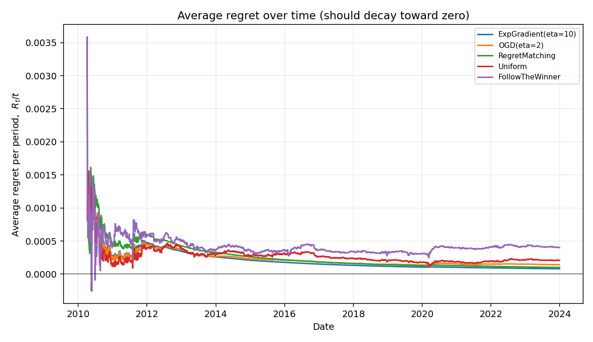

# No-Regret Allocator

[](https://github.com/coreyczhang/no-regret-allocator/actions/workflows/ci.yml)
[](https://www.python.org/)
[](LICENSE)
[](https://github.com/psf/black)
[](https://mypy-lang.org/)

**An online no-regret learning framework for adaptively allocating capital across trading strategies.**

Given a set of `N` candidate trading strategies, this project observes each
strategy's realized return every period and uses a *no-regret online learning*
algorithm to dynamically reweight how capital is split across them. The
guarantee that makes this interesting: without knowing in advance which strategy
will do best, the allocator provably approaches — in hindsight — the performance
of the best fixed allocation, with a performance gap that grows *sublinearly* in
time.

> **This is a research / educational implementation. It is not investment
> advice.** The bundled strategies are deliberately simple and illustrative; no
> claim is made that any of them is a good trading idea. The contribution here
> is the meta-algorithm that allocates *across* strategies, not the strategies.

---

## The problem: online portfolio selection

Classic portfolio optimization assumes you know the distribution of returns and
solves for weights once. **Online** portfolio selection drops that assumption:
returns arrive one period at a time, possibly chosen adversarially, and you must
commit to an allocation *before* seeing the next period's outcome. You never get
to peek ahead, and the "right" strategy can change over time.

A tempting heuristic is to just pile into whatever worked last period. That fails
badly (see the `FollowTheWinner` baseline below): an adversary can flip the
winner every period so the chaser is always one step behind, and even on real
data it pays enormous transaction costs while whipsawing.

No-regret online learning offers a principled alternative. You do **not** need to
predict which strategy will win. You only need an update rule whose cumulative
performance is guaranteed to stay close to the best fixed allocation *chosen with
hindsight*. That is exactly what these algorithms provide.

## Why "no regret" is the right idea

Define **regret** as the gap, after `T` periods, between the best fixed
allocation in hindsight and what the learner actually earned:

```
Regret_T  =  max_{u in simplex}  sum_t  u · r_t   −   sum_t  w_t · r_t
             \_______________________________/       \________________/
              best fixed allocation, in hindsight      what we earned
```

where `r_t` is the vector of the `N` strategies' realized returns in period `t`
and `w_t` is the allocation the learner held. An algorithm is **no-regret** if
`Regret_T / T → 0` as `T → ∞`: the *average* per-period gap to the best fixed
allocation vanishes. Crucially, this holds *for every possible return sequence*,
including adversarial ones — it is a worst-case guarantee, not a distributional
one.

**Plain-English intuition for the bound.** These algorithms guarantee
`Regret_T = O(√T)` (up to a `√(log N)` factor). Since `√T` grows much more
slowly than `T`, dividing by `T` drives the average regret to zero like
`1/√T`. So the longer you run, the more indistinguishable you become from the
best fixed allocation you *could* have picked if you had known the whole future
in advance — without ever having known it. This is the online-learning analogue
of Cover's classic result that a "universal portfolio" asymptotically matches
the best constant-rebalanced portfolio.

The single most important plot in this repo (`figures/regret.png`) is the direct
empirical evidence: the average-regret curves of the learners decay toward zero,
while fixed and naive baselines flatten out at a positive gap.

## The algorithms

All learners share one interface — `update(realized_returns) -> new_weights` —
and always output a valid allocation on the probability simplex (non-negative,
sums to 1: long-only, fully invested).

| Learner | Update rule | Reference |
|---|---|---|
| **Exponentiated Gradient / Multiplicative Weights** | `w_i ← w_i · exp(η · r_i)`, renormalize | Helmbold, Schapire, Singer & Warmuth (1998); Cover (1991) |
| **Online Gradient Descent (OGD)** | `w ← Proj_simplex(w + η · r)` | Zinkevich (2003); simplex projection: Duchi et al. (2008) |
| **Regret Matching** | allocate ∝ positive part of cumulative regret `[R_i]⁺` | Hart & Mas-Colell (2000) |
| **Uniform** *(baseline)* | hold `1/N` every period | — |
| **Follow-the-Winner** *(naive baseline)* | full weight on last period's best strategy | — |

The two baselines exist to show the no-regret learners add real value over
naive heuristics — both a "do nothing adaptive" benchmark (uniform) and a
"chase the hot hand" benchmark (follow-the-winner).

### A note on learning-rate scale

These learners minimize regret in the *linear-reward* ("prediction with expert
advice" / Hedge) setting, where each strategy is an expert with per-period gain
`r_i` and the learner's gain is `w · r`. In that setting the best fixed
allocation for the linear objective is a vertex of the simplex — the single best
strategy by summed return — which is what the regret is measured against.

Because daily returns are small (~1e-2), the effective step per period is
`η · r`, so meaningful adaptation requires `η` on the order of 1–20, not the
`~0.05` you might expect from textbook pseudocode written for `O(1)` losses.
The learning-rate sensitivity sweep (`figures/lr_sensitivity.png`) makes the
tradeoff explicit and is used to pick each algorithm's default.

For the multiplicative-wealth picture we additionally report the best
**constant-rebalanced portfolio** (the interior, hindsight-optimal fixed mix
behind Cover's universal portfolios), computed by convex optimization over the
simplex.

## Empirical results

Backtest over five liquid ETFs (SPY, QQQ, IWM, TLT, GLD), 2010–2023, with four
illustrative strategies (equal-weight buy-and-hold, cross-sectional momentum,
short-horizon mean reversion, and a volatility-targeting overlay). Reproduce
everything with `python scripts/run_backtest.py`.

### Cumulative wealth


The no-regret learners track the hindsight-optimal constant-rebalanced portfolio
closely and finish above both baselines, while the naive winner-chaser is far
and away the worst.

### Average regret over time — the no-regret property



The learners' average regret decays toward zero, empirically confirming the
theory. The fixed `Uniform` baseline instead settles at a small *positive*
constant (it is a fixed mix, so its per-period gap to the best strategy does not
vanish), and `FollowTheWinner` settles higher still.

### Learning-rate sensitivity


OGD shows the classic U-shape — too small and it adapts slowly, too large and its
single-step gradient becomes unstable (optimum near `η ≈ 2`). Exponentiated
Gradient, whose softmax update is smooth in the *cumulative* returns, improves
monotonically and then plateaus, tolerating much larger rates.

### Summary metrics

| Learner | Total return | Sharpe | Avg turnover | Final regret | Final avg regret |
|---|---:|---:|---:|---:|---:|
| ExpGradient (η=10) | **5.79×** | 0.95 | **0.008** | **0.28** | 0.0001 |
| RegretMatching     | 5.32× | 0.91 | 0.014 | 0.35 | 0.0001 |
| OGD (η=2)          | 4.72× | 0.97 | 0.022 | 0.49 | 0.0001 |
| Uniform *(baseline)* | 3.76× | **1.04** | 0.000 | 0.72 | 0.0002 |
| FollowTheWinner *(naive)* | 1.32× | 0.50 | 1.347 | 1.39 | 0.0004 |

**Honest read of the tradeoffs.**

- All three no-regret learners beat both baselines on total return and end with
  markedly lower regret than the naive winner-chaser.
- **Exponentiated Gradient** performs best here on return *and* turnover: its
  softmax reallocates smoothly, so it drifts toward the strong strategy without
  churning. Note this runs counter to the common textbook expectation that
  multiplicative weights is the higher-turnover method — with comparable,
  well-chosen learning rates on this data it is the *lowest*-turnover adaptive
  learner, because OGD's Euclidean projection tends to snap toward simplex
  corners, producing more abrupt rebalances.
- **Regret Matching** is competitive and parameter-free (no learning rate to
  tune), which is a real practical advantage.
- **OGD** is solid but the most sensitive to its step size (see the sweep).
- **Uniform** has the *best Sharpe* despite a lower total return: equal weighting
  diversifies away volatility, whereas the no-regret learners chase return by
  concentrating on the best strategy and so carry more concentration risk. Raw
  growth and risk-adjusted growth are genuinely different objectives — a useful
  caveat, since the regret here is defined on returns, not on risk-adjusted
  returns.
- **Turnover matters.** `FollowTheWinner`'s turnover of ~1.35 per period would be
  obliterated by transaction costs in practice; the adaptive learners keep
  turnover one to two orders of magnitude lower.

## Using the library directly

Every learner is a few lines to drive — feed it each period's realized returns
and it hands back the next allocation:

```python
import numpy as np
from nra.learners import ExponentiatedGradient

learner = ExponentiatedGradient(n=4, eta=10.0)   # 4 strategies
weights = learner.weights                         # starts uniform: [0.25, 0.25, 0.25, 0.25]

for realized_returns in stream_of_period_returns:   # each a length-4 array
    weights = learner.update(realized_returns)      # always a valid simplex point
```

Swap in `OnlineGradientDescent`, `RegretMatching`, `Uniform`, or
`FollowTheWinner` without changing anything else. Adding a new algorithm means
subclassing `Learner` and implementing a single `_step` method.

## Architecture

```
src/nra/
├── strategies/     # Strategy ABC + toy strategies (buy&hold, momentum,
│                   #   mean-reversion, vol-target) → per-period return series
├── learners/       # Learner ABC + EG, OGD, Regret Matching, and baselines,
│                   #   all sharing update(realized_returns) -> new_weights
├── backtest/       # data loading (cached CSV / yfinance) + run loop,
│                   #   wealth / regret / Sharpe / turnover, hindsight benchmarks
├── analysis/       # wealth, regret-over-time, and learning-rate sweep plots
├── simplex.py      # probability-simplex projection & validation utilities
└── cli.py          # `nra-backtest` entry point
```

Clean abstract base classes (`Strategy`, `Learner`) make new strategies and new
algorithms easy to add. The code is fully type-annotated, `black`-formatted,
`mypy`-clean, and vectorized with NumPy (no Python loops over long series where a
vectorized op will do; the only per-period loop is the inherently sequential
online-learning update).

## Reproducing the results

```bash
git clone https://github.com/coreyczhang/no-regret-allocator.git
cd no-regret-allocator
python -m pip install -e .

# Run the full backtest and (re)generate figures/ + the metrics table.
python scripts/run_backtest.py
# or, after install:  nra-backtest
```

The repository ships a **cached price panel** (`data/prices.csv`) so the backtest
and the test suite run fully offline and reproducibly — no network access
required. To refresh the data from source (needs the optional `yfinance` extra):

```bash
python -m pip install -e ".[data]"
python scripts/fetch_data.py --start 2010-01-01 --end 2024-01-01
```

## Testing

```bash
python -m pip install -e ".[dev]"
pytest
```

The suite verifies the properties that matter:

- **Valid simplex** — every learner's weights are non-negative and sum to 1 at
  every step, and the simplex projection returns the true closest point.
- **Zero learning rate ⇒ frozen weights** — with `η = 0`, the rate-based
  learners never move off their initialization (uniform reduces to uniform).
- **No-regret behavior on synthetic data** — on a stationary panel with one
  known-best strategy, the learners concentrate on it, drive average regret near
  zero, and their `|R_t / t|` envelope shrinks (sublinear regret) — while the
  naive baseline ends with strictly higher regret.
- **Strategy correctness** — finite, aligned return series and no look-ahead
  (perturbing the last price never changes an earlier position's return).

## Stretch goal: a C++ core

The online update loop is the one inherently sequential, performance-critical
part. A natural extension is to reimplement `Learner._step` in C++ behind a
`pybind11` binding, keeping the exact same Python `Learner` interface and test
suite. This is documented as a future direction rather than implemented here;
the Python core is already vectorized and fast enough for the scales in this
project.

## References

- T. M. Cover (1991). *Universal Portfolios.* Mathematical Finance, 1(1), 1–29.
- S. Hart & A. Mas-Colell (2000). *A Simple Adaptive Procedure Leading to
  Correlated Equilibrium.* Econometrica, 68(5), 1127–1150.
- D. P. Helmbold, R. E. Schapire, Y. Singer & M. K. Warmuth (1998). *On-line
  Portfolio Selection Using Multiplicative Updates.* Mathematical Finance,
  8(4), 325–347.
- M. Zinkevich (2003). *Online Convex Programming and Generalized Infinitesimal
  Gradient Ascent.* ICML.
- J. Duchi, S. Shalev-Shwartz, Y. Singer & T. Chandra (2008). *Efficient
  Projections onto the ℓ1-Ball for Learning in High Dimensions.* ICML.

## License

MIT — see [LICENSE](LICENSE).
